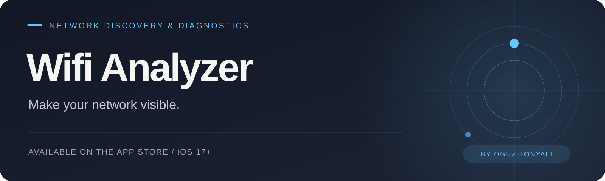
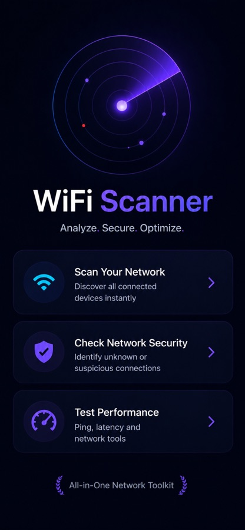
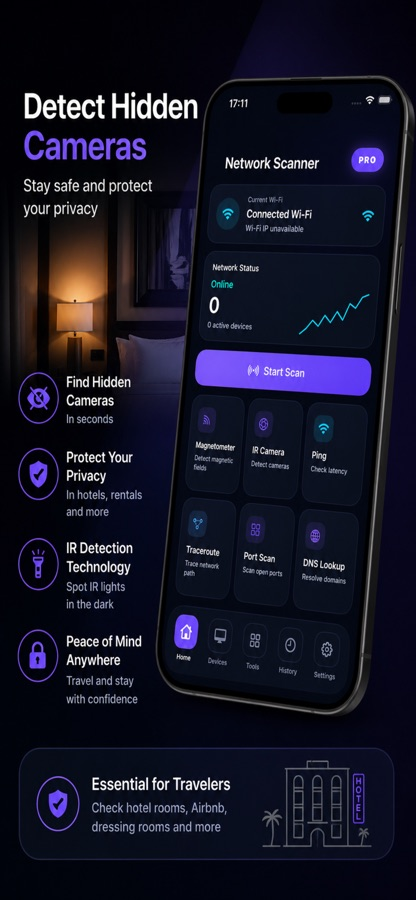
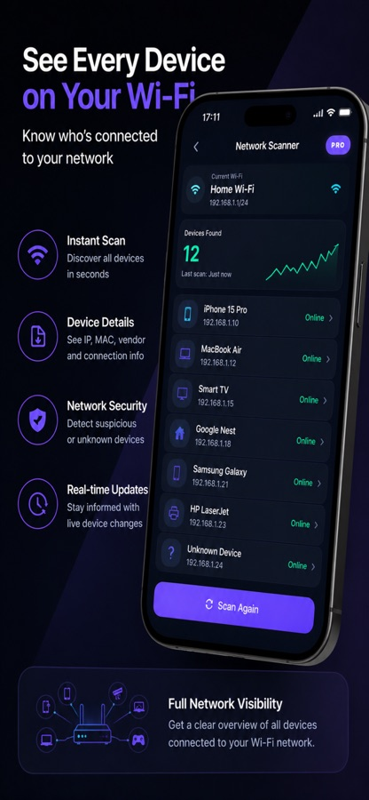

  <a href="https://apps.apple.com/us/app/wifi-analyzer-scan-network/id6764405400"><strong>View on the App Store ↗</strong></a> &nbsp; · &nbsp;
  <a href="docs/ENGINEERING.md">Engineering notes</a> &nbsp; · &nbsp;
  <a href="https://github.com/Zodomik">More by Oğuz Tonyalı</a>

## Wifi Analyzer

A network toolkit for discovering devices and understanding a local connection. A scan-first interface brings network information and diagnostic tools into a single native iOS app.

Built and published by **[Oğuz Tonyalı](https://github.com/Zodomik)**. This repository is a public product and engineering showcase; the application source is maintained privately.

## A look inside

  
  
  

*Official product previews from the [App Store listing](https://apps.apple.com/us/app/wifi-analyzer-scan-network/id6764405400).*

## What you can do

- Local network device discovery and connection overview.
- Host reachability, port checks, DNS and IP/subnet tools.
- Saved devices and scan history.
- Magnetic-field and camera-based companion tools.

## Technology

| Area | Technologies | Role in the product |
| --- | --- | --- |
| Interface | Swift, SwiftUI, Combine | Scan progress, discovery results and diagnostic views. |
| Networking | Network framework, Foundation, Darwin | Connections, host probes and interface/address utilities. |
| Discovery | Bonjour / NetServiceBrowser | Service discovery and device-name resolution. |
| Local history | Codable, UserDefaults | Persisted scan records and saved devices. |
| Access and sensors | StoreKit, RevenueCat, Core Motion | Premium access and magnetic-field readings. |

## Implementation notes

SwiftUI client; on-device Network/Bonjour discovery; Codable/UserDefaults scan history; public lookup services for selected diagnostics.

- Batched host/port task groups and progressive AsyncStream events.
- A one-shot completion guard resolves connection/timeout races.
- Bitwise subnet calculations and adaptive magnetic-field baselines.

| Read more | What is covered |
| --- | --- |
| [Architecture and frameworks](docs/ENGINEERING.md) | Runtime components, backend structure and framework responsibilities |
| [Database and local data](docs/DATA_MODEL.md) | Entities, relationships, constraints and persistence choices |
| [Algorithms and implementation choices](docs/ALGORITHMS.md) | Calculations, example flows and the limits of each approach |

## Try the product

**[Open Wifi Analyzer on the App Store](https://apps.apple.com/us/app/wifi-analyzer-scan-network/id6764405400)** · Requires iOS 17 or later.

Availability and purchase options are shown in the store. For product support, use the developer links on the App Store listing.

---

[All published apps](https://apps.apple.com/us/developer/oguz-tonyali/id1880078720) · [Developer profile](https://github.com/Zodomik) · [Media credits](assets/SOURCES.md)
