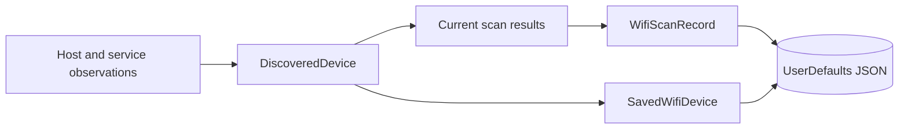

# Wifi Analyzer · Local data model

Scan history and saved devices use **Codable models encoded as JSON in UserDefaults**. Live scan events and device arrays exist in memory. There is no custom PostgreSQL, Firebase or cloud scan database in this implementation.

| Model / state | Purpose |
| --- | --- |
| WifiNetworkInfo | Current interface/network summary |
| DiscoveredDevice | Name, IP, available/inferred metadata, response time, status and open ports |
| WifiScanRecord | Persisted snapshot of a completed scan |
| SavedWifiDevice | User-retained device identity/metadata |
| Diagnostic snapshots | Typed host/port/DNS/route/subnet results for tool views |
| Preferences | Small settings stored through UserDefaults |

## Observation versus identity

The scan implementation does not manufacture a MAC address when one is unavailable. Name/vendor/type fields can be inferred from response signals, and some Bonjour-derived values are display defaults rather than probe measurements. They should be interpreted as discovery metadata, not a hardware inventory guarantee.

IP addresses are observations from a scan, not permanent device identities. DHCP changes and service visibility can affect comparisons between sessions.

## Persistence boundary

The history store loads and saves encoded record arrays and saved-device arrays. Diagnostic snapshots are produced by services; they are not normalized SQL tables. No SQL foreign keys or cross-device sync mechanism is implied by the diagrams.

[Architecture](ENGINEERING.md) · [Algorithms](ALGORITHMS.md)
