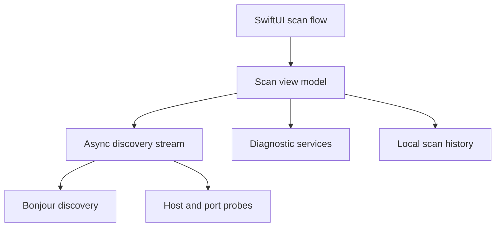

# Wifi Analyzer · Engineering notes

This overview describes the product’s implementation at a component level. It accompanies the [product showcase](../README.md).

## Component map

The diagram emphasizes responsibilities and data flow. Platform integrations can have their own independent lifecycle.

## Design decisions

### Progressive discovery

An asynchronous scan stream can surface results as hosts are examined. This supports a visible scanning state instead of making the interface wait for one final response.

### Multiple signals for device context

Bonjour services, resolved names and reachable ports contribute to the discovered-device model. Labels inferred from those signals are useful context rather than guaranteed hardware identity.

### Services behind the interface

Scanning, diagnostic probes and history storage are separate components. The view model can coordinate work and publish progress without embedding network operations in individual SwiftUI views.

## Stack reference

| Area | Technologies | Responsibility |
| --- | --- | --- |
| Interface | Swift, SwiftUI, Combine | Scan progress, discovery results and diagnostic views. |
| Networking | Network framework, Foundation, Darwin | Connections, host probes and interface/address utilities. |
| Discovery | Bonjour / NetServiceBrowser | Service discovery and device-name resolution. |
| Local history | Codable, UserDefaults | Persisted scan records and saved devices. |
| Access and sensors | StoreKit, RevenueCat, Core Motion | Premium access and magnetic-field readings. |

## Scope

The technology summary was checked against the application’s Swift imports, project configuration and relevant service/model implementations. Backend technologies, where listed, were checked against the associated package manifest and database schema. Store screenshots illustrate the released product; the private working project may continue evolving after release.

This documentation publishes no credentials, deployment configuration, private endpoints or application source. Product behavior and supported devices are described in the [current App Store listing](https://apps.apple.com/us/app/wifi-analyzer-scan-network/id6764405400).
