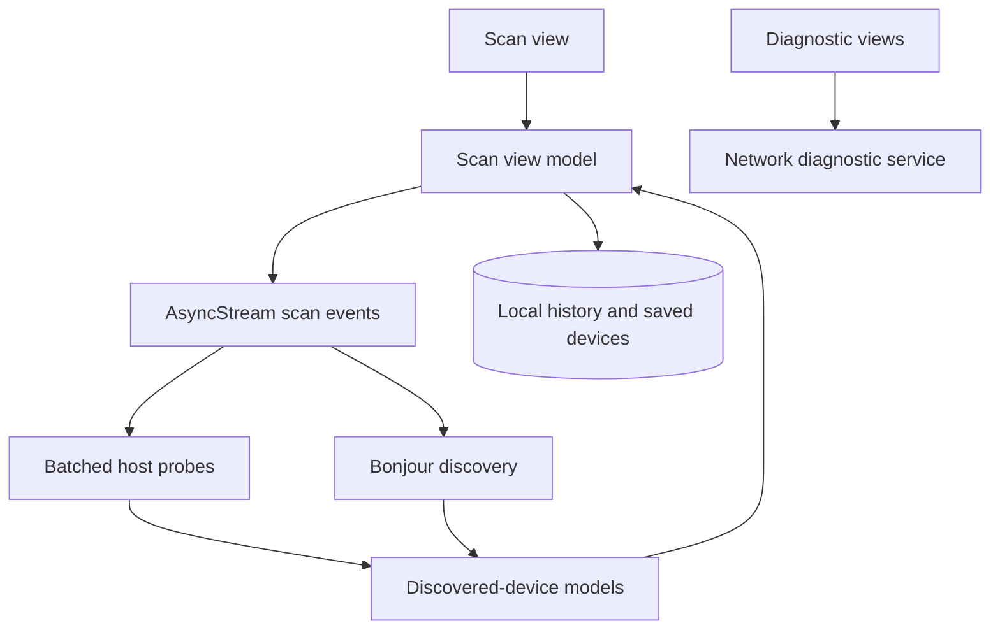

# Wifi Analyzer · Architecture

*Implementation notes checked against the working project on 20 November 2026. Store builds may differ as the project evolves.*

The app combines a native local-network scanner, diagnostic services and device-sensor tools. Discovery and scan history run on the device; there is no custom scan backend or server device database.

| Component | Framework / technology | Responsibility |
| --- | --- | --- |
| Interface/state | Swift, SwiftUI, Combine | Scan lifecycle, progress, device lists and tool screens |
| Concurrent discovery | AsyncStream, Task, task groups | Progressive events and bounded batches of host/port work |
| TCP probing | Network / NWConnection | Connection attempts and response classification |
| Discovery/names | Bonjour, NetServiceBrowser, Foundation, Darwin | Service discovery, reverse lookup and interface inspection |
| Persistence | Codable JSON, UserDefaults | Scan records, saved devices and preferences |
| Sensor tools | Core Motion, AVFoundation, Core Image | Magnetic-field readings, camera capture and image processing |
| Purchases | RevenueCat, StoreKit | Premium access and restore flow |

## Discovery pipeline

The scanner determines the Wi-Fi IPv4 address, builds host candidates and starts Bonjour discovery alongside the probing pass. Host batches use task groups. Each batch emits discovered devices and progress, followed by the Bonjour merge and completion events.

The view model consumes this stream, so the interface can show progress before the entire scan has finished. Terminating the stream requests cancellation of the scan task. Cancellation checks also occur between host batches.

## What diagnostics actually measure

The ping-style diagnostic measures TCP connection outcomes and elapsed time. DNS tools use name/address resolution. The route view creates a local/gateway/public-address summary; the implementation does not perform a raw ICMP hop-by-hop traceroute. IP arithmetic uses the interface address and netmask.

Public-IP and RDAP lookups call external HTTP services. That is different from operating a custom application backend or synchronizing the scan database to a server.

Device names/types can be inferred from service types, reverse names and open ports. A closed-but-responding TCP endpoint can still establish host reachability. These observations do not guarantee a device’s manufacturer or security status.

## Sensor and image processing

The magnetometer smooths readings and compares magnitude with an adaptive baseline. The camera component uses AVFoundation for capture and Core Image for contrast and false-color processing of captured images. False-color rendering is a visual transform; it does not turn a normal camera into a temperature sensor.

**Code landmarks:** `WifiScanViewModel`, `SystemLocalNetworkScanner`, `NetworkDiagnosticsService`, `BonjourDeviceDiscovery`, `WifiScanHistoryStore`, `MagnetometerViewModel` and `InfraredCameraViewModel`.

**Continue:** [Local data model](DATA_MODEL.md) · [Algorithms](ALGORITHMS.md) · [Product](../README.md)
